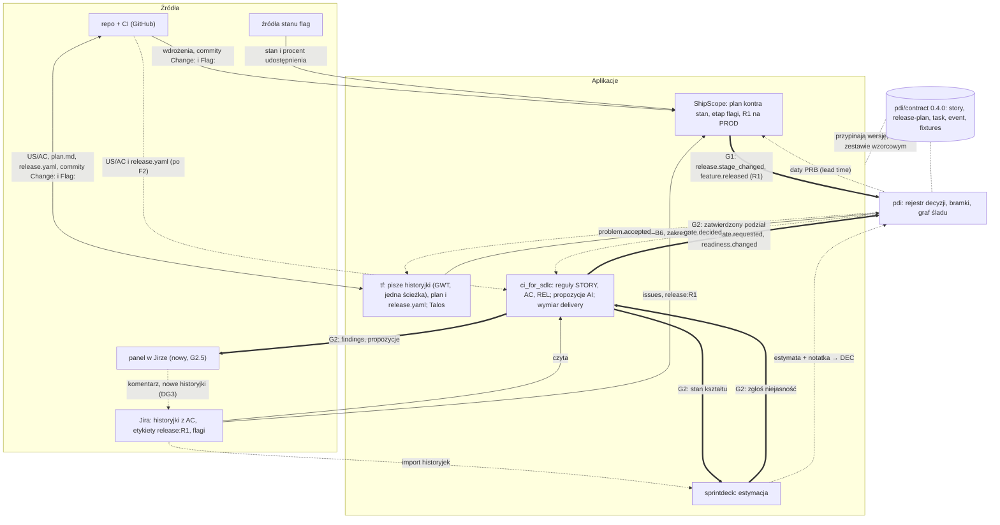

# Plan wydania i kształt historyjek — plan domknięcia luk G1 i G2

Data: 2026-10-25 · Status: **w realizacji**: tryb Jira i tryb repo w ShipScope zrobione, G2.3 wstrzymane (stan w §10; [plan K0](plan-k0-kontrakt-040.md)); decyzje DG1–DG7 przyjęte w [`decyzje.md`](decyzje.md) · Wersja HTML: https://claude.ai/artifact/G9Z2ubF7EtoWxMST1M7Gy1

Szczegółowy plan dla dwóch luk z mapy ekosystemu (https://claude.ai/artifact/9gz1UhJZRNXHq5VgUciava): **G2** —
kształt historyjki i kryteriów akceptacji, **G1** — plan wydania i MVP. Dla każdej: reguły, zmiany w konkretnych
plikach każdego repozytorium, kolejność kroków i to, co działa po każdym z nich. Uzupełnia
[plan jednego flow](plan-jeden-flow-sdlc.md); kroki zależne od jego faz (F1, F2, F4–F5) są oznaczone.

## 1. Najważniejsze ustalenia

| Ustalenie | Uzasadnienie |
|---|---|
| **Najpierw G2, potem G1** | Plan wydania składa się z historyjek. Reguła „MVP bez historyjek warstwowych” korzysta z reguły kształtu z G2, a zatwierdzony podział historyjek daje materiał na linie wydań. |
| **Bez nowego produktu** | Obie luki zamykają zmiany w ci_for_sdlc, tf, pdi i ShipScope. Potrzebny jest jeden nowy komponent: panel w Jirze (§6). |
| **Najpierw tryb Jira** | ci_for_sdlc już czyta Jirę, więc reguły dają wartość od razu. Tryb repo (`changes/CHG-n/`) dochodzi po konektorze repo z F2. |
| **Jedna definicja dobrej historyjki** | tf (Python) i ci_for_sdlc (TypeScript) sprawdzają to samo. Wspólny zestaw wzorcowy w kontrakcie pdi pilnuje, żeby obie implementacje się nie rozjechały. |

## 2. Decyzje do podjęcia przed startem

Po przyjęciu trafiają do [`decyzje.md`](decyzje.md).

| ID | Pytanie | Rekomendacja | Dlaczego |
|---|---|---|---|
| DG1 | Domyślny format kryteriów akceptacji | **Given/When/Then**, EARS jako opcja w ustawieniach | tf (`proc-agile`, `proc-requirements-shaping`) i jego linter już wymagają GWT; EARS lepiej pasuje do wymagań systemowych bez interfejsu |
| DG2 | Języki słów kluczowych | **EN i PL** (Given/When/Then oraz Zakładając/Gdy/Wtedy, jak w Gherkinie) | `requirements_lint.py` rozpoznaje już oba warianty |
| DG3 | Zapis do Jiry | **Etapami:** kopiuj jako tekst → komentarz → tworzenie historyjek po zatwierdzeniu | dziś konektor jest tylko do odczytu; zapis wymaga zakresu OAuth `write:jira-work` |
| DG4 | Jak oznaczyć linię wydania (MVP) w Jirze | **Etykieta z prefiksem** `release:R1`, konfigurowalna (etykieta, fixVersion albo pole) | fixVersion zwykle oznacza wersję wdrożenia (2.4.0), nie MVP; ten sam wzorzec konfiguracji ma ShipScope dla flag (`jira_connections.flag_link`) |
| DG5 | Nowy wymiar gotowości epiku | **Tak:** wymiar `delivery` („Plan wydania”), tylko dla epiku i feature'a | bez niego reguły planu wydania nie wpływają na gotowość epiku |
| DG6 | Gdzie żyje plan wydania w repo | **Osobny** `changes/CHG-n/release.yaml` | nagłówek artefaktu zmiany ma zostać płaskim YAML (kontrakt 0.3.0); plan wydania ma strukturę zagnieżdżoną i czyta go maszyna |
| DG7 | Jeden panel w Jirze dla całego ekosystemu | **Tak**, jedna aplikacja Forge z panelami ci_for_sdlc, ShipScope i pdi | [dokument 14](14-pdi-standalone.md) planuje punkt zapisu decyzji w Jirze; trzy osobne aplikacje to trzy instalacje u klienta |

## 3. K0 — wspólny krok: kontrakt 0.4.0

Obie luki zaczynają się od kontraktu, bo korzystają z niego wszystkie repozytoria. Jeden PR, jedna zmiana wersji;
wszystkie pola są nowe i opcjonalne.

| Plik w `pdi/` | Zmiana | Dla |
|---|---|---|
| `contract/story.schema.json` (nowy) | Historyjka z identyfikowalnymi kryteriami: `id` (US-n), `actor`, `capability`, `benefit`, `scenarios[]` z `id` (AC-n), `format` (gwt / ears), `given[]`, `when`, `then[]`. Dla eksportu z tf i konektora repo ci_for_sdlc (F2). | G2 |
| `contract/fixtures/story-shape/` (nowy katalog) | Wzorcowe historyjki, dobre i złe, po polsku i angielsku (cel: ok. 40), oraz `expected.json`: które reguły powinny zadziałać na której historyjce. Testy ci_for_sdlc i tf przechodzą po tym samym zestawie. | G2 |
| `contract/release-plan.schema.json` (nowy) | Plan wydania zmiany: `mvp` (wynik, metryka, horyzont, metryki ochronne), `releases[]` (R1…Rn z listą TSK), `flags[]` (klucz, cięcia, właściciel, `remove_by`, etapy `rollout[]` z kryterium wyjścia i minimalnym czasem). | G1 |
| `contract/task.schema.json` | Nowe pola opcjonalne: `kind` (slice / foundation, jak S-NN i F-NN w tf), `release` (R1…), `flag`, `unblocks[]`, `skeleton` (pierwsze cięcie end-to-end). | G1 |
| `contract/event.schema.json` | W `feature.released` opcjonalne `release` (R1 wydane = MVP u ludzi). Nowe zdarzenie `release.stage_changed` (ShipScope → pdi): `change`, `release`, `flag`, `from_stage`, `to_stage`, `rollout`. | G1 |
| `contract/README.md`, `contract.json` | Wersja 0.4.0; opis formatu AC (słowa kluczowe EN/PL, EARS); konwencje Jiry z domyślnymi wartościami: `release:` dla linii wydania, ta sama konwencja flag co w ShipScope. | G1, G2 |
| `src/pdi/contract.py`, `tests/test_contract.py` | Walidacja nowych schematów (`contract.errors("release_plan", obj)`, `"story"`), testy na przykładach. | G1, G2 |
| `contract/examples/` | `story.json`, `release-plan.json`, `event-release.stage_changed.json`. | G1, G2 |
| `docs/plan-jeden-flow-sdlc.md` | Wpięcie kroków G1 i G2 w fazy F1–F5. | G1, G2 |

**Działa po kroku:** repozytoria mają wspólną, wersjonowaną definicję historyjki i planu wydania oraz zestaw
wzorcowy do testów.

Polecenia startowe dla fali 2 (G2.4 w tf, G2.1 w ci_for_sdlc): [`polecenia-startowe-fala-2.md`](polecenia-startowe-fala-2.md).

## 4. G2 — kształt historyjki i kryteriów akceptacji

### 4.1. Co jest dziś i czego brakuje

ci_for_sdlc sprawdza, czy historyjka ma AC (`REQ-001`), czy ma zdanie „As a … I want … so that” (`REQ-002`), czy AC
nie zawierają niejasnych słów (`REQ-003`) i czy każde AC ma task (`COV-001`). Konektor zamienia AC na listę punktów
(`bullets(acRaw)` w `packages/core/src/connectors/atlassian.ts`), więc scenariusz GWT rozpisany na trzy punkty jest dla
reguł trzema osobnymi kryteriami. tf zna wzorce cięcia historyjek (`proc-agile/references/mapa-i-dzielenie.md`)
i wymaga GWT dla głównego przepływu, ale tylko w rozmowie z agentem. Nikt nie wykrywa historyjki, która łączy kilka
funkcjonalności, ani AC bez obserwowalnego wyniku.

### 4.2. Nowe reguły (ci_for_sdlc)

Reguły deterministyczne wykrywają problem i zadają pytanie. AI dokłada propozycję poprawki (podział albo
przepisanie), zawsze z cytatem oryginalnego tekstu. Kategorie zostają bez zmian, żeby nie ruszać filtrów UI
i schematu AI.

| Reguła | Co wykrywa i jak | Kategoria | Domyślnie | Pytanie lub propozycja |
|---|---|---|---|---|
| STORY-001 | Jedna ścieżka na historyjkę. Sygnały: dwa czasowniki akcji połączone „i / oraz / lub / and / or / /” w tytule albo celu; więcej niż jeden aktor; scenariusze z różnymi akcjami w „When/Gdy” (co najmniej 2 różne pary czasownik + obiekt po normalizacji słownikiem). Przykład: „Jako klient chcę dodać, edytować i usunąć kartę” → 3 akcje. | AMBIGUITY | warning | „Podzielić na 3 historyjki?” Opcje: podziel według akcji (AI proponuje), zostaw jako jedną ścieżkę z uzasadnieniem. |
| STORY-002 | Za duża historyjka: więcej scenariuszy niż próg (domyślnie 6), więcej niż 3 różne akcje „When” albo estymata ≥ 13 (gdy w Jirze jest pole story points). | AMBIGUITY | warning | Propozycja podziału według wzorców SPIDR z tf (ścieżki, dane, reguły, interfejsy). |
| STORY-003 | Historyjka warstwowa: tytuł od warstwy (BE, FE, API, DB, endpoint, migracja, tabela) albo brak aktora i wyniku przy słownictwie technicznym. To task, nie historyjka. | GAP | warning | „Przenieść jako task pod historyjkę X czy przepisać jako wartość dla użytkownika?” |
| AC-001 | Format kryteriów: każdy scenariusz w formacie z ustawień (GWT albo EARS). Wolny tekst albo scenariusz bez „Then/Wtedy” łamie regułę. | AMBIGUITY | info (w ustawieniach do warning) | AI przepisuje na GWT, z cytatem oryginału; człowiek zatwierdza. |
| AC-002 | Brak obserwowalnego wyniku: „Then/Wtedy” bez stanu widocznego dla użytkownika albo systemu („działa poprawnie”, „jest obsłużone”, „is handled”, „works”). Nie odpala na kryterium, na którym zadziałał już `REQ-003`. | AMBIGUITY | warning | „Co dokładnie widzi użytkownik albo co zapisuje system, gdy …?” |
| AC-003 | AC opisuje implementację: dostawcy, schemat danych, mechanizm. Słownik przejęty z `LEAK_PATTERNS` w `requirements_lint.py` tf przez wspólny zestaw wzorcowy. Przykład: „Zapis do tabeli saved_cards”. | AMBIGUITY | info | „Jakie zachowanie ma opisywać to kryterium?” Przeniesienie szczegółu do tasku. |
| AC-004 | Kilka akcji w jednym scenariuszu („When … and when …”, kilka „Gdy”). | AMBIGUITY | info | Rozbicie scenariusza na dwa. |

### 4.3. Przykład: przed i po

Przed (PAY-140 w Jirze):

```
Zarządzanie zapisanymi kartami
Jako klient chcę dodać, edytować i usunąć kartę
oraz ustawić kartę domyślną.

Acceptance criteria:
- Karta jest zapisana poprawnie
- Zapis do tabeli saved_cards
- Usunięcie działa
- Można ustawić domyślną
```

Findings: `STORY-001` (4 akcje: dodaj, edytuj, usuń, ustaw domyślną), `AC-001` (brak scenariuszy GWT), `AC-002`
(„zapisana poprawnie”, „działa”), `AC-003` („tabela saved_cards”), `ERR-004` (istniejąca: brak potwierdzenia
usunięcia).

Propozycja AI do zatwierdzenia:

```
1. Klient dodaje kartę            (szkielet, R1)
   AC-1 Zakładając, że klient nie ma kart,
        gdy doda kartę z poprawnymi danymi,
        wtedy widzi ją na liście jako domyślną
        z ostatnimi 4 cyframi.
2. Klient ustawia kartę domyślną  (R1)
3. Klient usuwa kartę             (R2)
   AC-1 … wtedy widzi prośbę o potwierdzenie
        i po potwierdzeniu karta znika z listy.
4. Edycja karty                   → pytanie:
   „Czy klient edytuje kartę, czy dodaje nową?”
```

Każda pozycja cytuje fragment oryginału, z którego wynika. Zatwierdzenie zapisuje decyzję w ci_for_sdlc i w pdi
(`DEC-n`).

### 4.4. Zmiany w ci_for_sdlc

| Plik | Zmiana | Krok |
|---|---|---|
| `packages/core/src/analysis/acceptance.ts` (nowy) | Parser AC: grupuje punkty w scenariusze (GWT EN/PL, EARS, wolny tekst), nadaje `AC-n`, wyciąga akcję z „When” (czasownik + obiekt). | G2.1 |
| `packages/core/src/model.ts` | `RequirementItem`: `acScenarios?: AcScenario[]`, `storyPoints?: number`. `Finding`: `proposal?: Proposal` (rodzaj `split` albo `rewrite_ac`, proponowane historyjki lub scenariusze, dowody). | G2.1, G2.3 |
| `packages/core/src/analysis/vocabulary.ts` | Słowa kluczowe GWT EN/PL, wzorce EARS, słownictwo warstw, słabe wyniki („poprawnie”, „works”), spójniki łączące akcje. | G2.2 |
| `packages/core/src/analysis/rules.ts` | Reguły STORY-001…003 i AC-001…004 w tablicy `RULES` (albo w nowym pliku `story-shape.ts` dołączanym do `RULES`). | G2.2 |
| `packages/core/src/policy.ts` | `storyShape?: { acFormat: 'gwt' \| 'ears' \| 'any' \| 'off'; maxScenarios: number; maxActions: number }` z odczytem przez funkcję domyślną, jak `aiFindingsAction`. | G2.2 |
| `packages/core/src/connectors/atlassian.ts` | Opcjonalne pole story points (`storyPointsField`, jak `acceptanceCriteriaField`). Pobieranie AC bez zmian; grupowanie robi parser. | G2.1 |
| `packages/core/src/connectors/demo.ts` | Historyjki demo, na których każda nowa reguła odpala i na których milczy. Bez tego nie przejdzie `test/rule-coverage.test.ts`. | G2.2 |
| `packages/core/src/ai/types.ts`, `ai/providers.ts` | Osobne wywołanie „Story shape reviewer”: własny prompt, schemat wyjścia z propozycjami, odrzucanie propozycji bez cytatu (jak dziś findings bez dowodu). | G2.3 |
| `packages/core/test/` | `acceptance.test.ts`, `story-shape.test.ts` na kopii `pdi/contract/fixtures/story-shape` z przypiętą wersją kontraktu; kontrakt AI w `ai-contract.test.ts`. | G2.1–G2.3 |
| `packages/server/src/app.ts`, `schemas.ts` | `POST /api/items/:key/proposals/:id/accept`: zapis decyzji (efekt `resolve`, wybrana propozycja w notatce). Test kontraktu API (`test:contract:update`). | G2.3 |
| `packages/web/` | Karta „Proponowany podział” przy findingu: proponowane historyjki z kolejnością i linią wydania, przyciski „Kopiuj jako tekst Jiry” i „Zatwierdź”. Ustawienia formatu AC w Settings → Policy. | G2.2, G2.3 |
| `e2e/item.spec.ts`, `e2e/settings.spec.ts` | Nowe przypadki ITM (propozycja, zatwierdzenie) i SET (format AC). | G2.2, G2.3 |
| `README.md`, `FAQ.md`, `docs/ROADMAP.md` | Opis reguł, ustawień i propozycji. | G2.3 |

### 4.5. Zmiany w tf

| Plik | Zmiana | Krok |
|---|---|---|
| `packs/pack-it/skills/proc-requirements-shaping/SKILL.md` | Faza 4: każda historyjka `US-NN` ma co najmniej jeden scenariusz `AC-n` w GWT (dziś tylko główny przepływ) i jedną akcję użytkownika; więcej akcji → podział według `mapa-i-dzielenie.md`. | G2.4 |
| `…/proc-requirements-shaping/scripts/requirements_lint.py` | Nowe sprawdzenia: historyjka bez scenariusza, scenariusz bez „Then/Wtedy”, kilka akcji „When” w historyjce, wynik nieobserwowalny. Nowe problemy jako ostrzeżenia (kod 0); `--strict` zamienia je w kod 1, żeby nie łamać istniejących projektów. | G2.4 |
| `tests/` (repo tf) | Test lintera na kopii zestawu wzorcowego z pdi; wynik musi zgadzać się z `expected.json`. | G2.4 |
| `packs/pack-it/skills/proc-agile/references/mapa-i-dzielenie.md` | Sekcja „Sygnały, że historyjka miesza funkcjonalności”: te same sygnały co STORY-001…003, z odesłaniem do wzorców podziału. | G2.4 |
| `modes/mode-talos/skills/talos-story-run/SKILL.md` | §1 Przyjęcie: lint historyjki. AC bez GWT → przepisz jako [założenie] i pokaż człowiekowi; z `--auto` historyjka łamiąca STORY-001 kończy się blokiem STOP z propozycją podziału. | G2.4 |
| `packs/pack-it/skills/qa-spec-first-testing/SKILL.md` | Test akceptacyjny nazwany identyfikatorem scenariusza (`US-02/AC-3`). To podstawa śladu AC → test z luki G4. | G2.4 |

### 4.6. Pozostałe zmiany

| Gdzie | Zmiana | Krok |
|---|---|---|
| nowe repo: panel w Jirze (Atlassian Forge) | Panel w widoku issue: gotowość z ci_for_sdlc, findings STORY/AC, propozycja podziału. „Zastosuj” najpierw dodaje komentarz z propozycją, później (DG3) tworzy historyjki i zapisuje decyzję w pdi. Wymaga publicznie dostępnego ci_for_sdlc (tryb SaaS z `docs/SAAS.md`), bo Forge nie sięga do lokalnej instalacji. | G2.5 |
| ci_for_sdlc: `connectors/atlassian.ts`, `docs/CONNECT-ATLASSIAN.md` | Zapis komentarza i tworzenie historyjek: zakres `write:jira-work`, wpis w audycie z listą zmian. | G2.5 |
| sprintdeck: `src/features/room` (po MVP pokoi) | Pokój pokazuje stan kształtu historyjki przed głosowaniem. Wynik „dwa obozy” albo „szeroki rozrzut” daje przycisk „Zgłoś niejasność”, który tworzy pytanie w ci_for_sdlc (nowe pochodzenie findingu `team` obok `rule`, `ai`, `drift`). | G2.6 |

### 4.7. Kroki

| Krok | Repo | Zależy od | Rozmiar | Zakres | Działa po kroku |
|---|---|---|---|---|---|
| G2.1 | ci_for_sdlc | K0 | S | parser AC, pola `acScenarios` i `storyPoints`, testy na zestawie wzorcowym; `COV-001` może liczyć pokrycie scenariuszami | ci_for_sdlc widzi scenariusze GWT jako całość i zna ich identyfikatory |
| G2.2 | ci_for_sdlc | G2.1 | M | siedem reguł, słownictwo EN/PL, ustawienia `storyShape`, dane demo, UI ustawień, e2e; kalibracja do precyzji ≥ 0,8 | każda historyjka w Jirze dostaje findings o kształcie i AC z pytaniem do PO; CLI `--fail-on` może je egzekwować w CI |
| G2.3 | ci_for_sdlc | G2.2 | M | osobne wywołanie AI ze schematem propozycji, odrzucanie propozycji bez cytatu, karta w UI, zatwierdzenie jako decyzja; propozycja nigdy nie zmienia gotowości bez człowieka | PO dostaje gotowy podział i przepisane AC do skopiowania do Jiry, a zatwierdzenie zostaje w logu decyzji |
| G2.4 | tf | K0 | S | skille i `requirements_lint.py` z §4.5, równolegle z G2.1–G2.3 | wymagania pisane z agentem mają GWT, jedną ścieżkę na historyjkę i identyfikatory AC; Talos nie zaczyna historyjki, która miesza ścieżki |
| G2.5 | panel Forge + ci_for_sdlc | G2.3, tryb SaaS | L | najpierw odczyt i komentarz, potem tworzenie historyjek po DG3 | PO widzi problemy z historyjką w trakcie pisania, bez przechodzenia do osobnej aplikacji |
| G2.6 | sprintdeck + ci_for_sdlc | G2.2, MVP sprintdecka z importem z Jiry | S | stan kształtu w pokoju, „Zgłoś niejasność” | rozbieżność estymat staje się pytaniem przy historyjce |

### 4.8. Jak sprawdzimy, że działa

- Na zestawie wzorcowym: precyzja reguł STORY i AC co najmniej 0,8, czułość co najmniej 0,7, ten sam wynik w tf
  i ci_for_sdlc.
- W pilocie (backlog z planowanego pilota F3): odsetek historyjek z AC w GWT rośnie do co najmniej 80% w ciągu
  6 tygodni.
- Odrzucane findings (`dismiss`) poniżej 20%. Wyżej oznacza szum i trzeba podnieść progi.
- Co najmniej połowa propozycji podziału zatwierdzona bez większych poprawek.

## 5. G1 — plan wydania i MVP

### 5.1. Co jest dziś i czego brakuje

tf planuje cięcia pionowe (`core-delivery-lifecycle/references/plan-ciec.md`: S-NN, F-NN z polem „Odblokowuje”,
gwiazda przewodnia) i pilnuje budżetu MVP w `proc-requirements-shaping`, ale plan nie ma linii wydań ani flag,
a szablon `plan.md` w `mode-pdi` to tylko tabela cięć. `eng-continuous-delivery` i `ops-release-engineering` opisują
flagi i etapy udostępniania jako wiedzę, bez artefaktu. ShipScope zna stan i procent udostępnienia każdej flagi oraz
jej powiązanie z ticketami, ale nie wie, co było planowane. ci_for_sdlc sprawdza tylko, czy epik ma cel (`EPIC-001`)
i historyjki (`EPIC-002`).

### 5.2. Model: plan wydania

Jeden obiekt łączy MVP z jego miarą, linie wydań, cięcia, flagi i etapy udostępniania. W trybie repo to plik
`release.yaml` zmiany. W trybie Jira te same informacje wynikają z konwencji: etykieta `release:R1` na historyjce,
sekcja „MVP” w opisie epiku, flaga powiązana tak jak dziś w ShipScope.

```yaml
# docs/project/changes/CHG-12/release.yaml   (kontrakt 0.4.0)
change: CHG-12
mvp:
  release: R1
  outcome: Klient może ponowić nieudaną płatność bez podwójnego obciążenia
  metric: { name: odzyskane_platnosci, target: ">= 25%", horizon_days: 30 }
  guardrails: [podwojne_obciazenia = 0]
releases:
  - { id: R1, name: MVP, tasks: [TSK-57, TSK-58] }
  - { id: R2, tasks: [TSK-59, TSK-60] }
flags:
  - key: payment-retry
    tasks: [TSK-57, TSK-58]
    owner: PO Payments
    remove_by: 2026-12-31
    rollout:
      - { stage: internal, min_days: 3, exit: "0 błędów krytycznych" }
      - { stage: "10%", min_days: 7, exit: "odzyskane >= 15%, duplikaty = 0" }
      - { stage: "100%" }
```

### 5.3. Nowe reguły (ci_for_sdlc)

Działają na epiku i feature'ze w trybie Jira oraz na zmianie (CHG) w trybie repo. Zasilają nowy wymiar gotowości
`delivery` (DG5).

| Reguła | Co wykrywa | Kategoria | Domyślnie | Tryb |
|---|---|---|---|---|
| REL-001 | MVP nie jest wyznaczone: epik z co najmniej 3 historyjkami i żadna nie ma linii R1. Pytanie: „Które historyjki tworzą MVP?” | GAP | warning | Jira, repo |
| REL-002 | MVP bez wyniku albo metryki z progiem i horyzontem. Uzupełnia `EPIC-001`, który sprawdza tylko cel epiku. | GAP | warning | Jira, repo |
| REL-003 | MVP to wszystko: R1 obejmuje więcej niż próg historyjek epiku (domyślnie 60%). „MVP zawiera 9 z 10 historyjek. Co można odłożyć?” | AMBIGUITY | warning | Jira, repo |
| REL-004 | MVP nie jest cienkim plastrem end-to-end: R1 zawiera historyjki warstwowe (`STORY-003`) albo AI wskazuje brakujący krok przepływu (jest „zapisz kartę”, nie ma „zapłać zapisaną kartą”), z cytatem. | GAP | warning | Jira, repo |
| REL-005 | Kolejność zależności: historyjka z R1 jest zablokowana („is blocked by”) przez historyjkę z późniejszej linii albo bez linii. | CONFLICT | critical | Jira, repo |
| REL-006 | Cięcie widoczne dla użytkownika bez flagi, gdy polityka jej wymaga (`requireFlag: user_facing \| all \| off`). Flagę czyta z tej samej konwencji co ShipScope. | GAP | warning | Jira, repo |
| REL-007 | Flaga bez planu: brak etapów, kryteriów wyjścia, właściciela albo daty usunięcia. | GAP | info | repo |
| REL-008 | Fundament bez „Odblokowuje” albo cięcie bez wymagania: ta sama samokontrola co w `plan-ciec.md` tf. | GAP | warning | repo |

### 5.4. Zmiany w tf (autor planu)

| Plik | Zmiana | Krok |
|---|---|---|
| `core/skills/core-delivery-lifecycle/references/plan-ciec.md` | Linie wydań: R1 = MVP, czyli gwiazda przewodnia plus minimum do wyniku. Nowe pola pozycji: „Wydanie”, „Flaga”. Samokontrola: R1 ma wynik i metrykę z `intent.md`; każde S w R1 jest widoczne dla użytkownika; S wdrażane przed decyzją o udostępnieniu ma flagę. | G1.1 |
| `core/skills/core-delivery-lifecycle/SKILL.md` | Tabela faz: wyjście fazy 5 to plan cięć i `release.yaml`; faza 8 wdraża według etapów z `release.yaml`, przejście etapu to bramka B5. | G1.1 |
| `modes/mode-pdi/skills/pdi-decisions/templates/release.yaml` (nowy), `plan.md` | Szablon planu wydania; w `plan.md` kolumny „Wydanie” i „Flaga”. | G1.1 |
| `modes/mode-pdi/skills/pdi-decisions/scripts/decision_record.py` | `change new` tworzy też `release.yaml`; `check` waliduje go schematem z kontraktu i sprawdza spójność: zbiór TSK w `release.yaml` równy zbiorowi w `plan.md`, każda flaga ma etapy i `remove_by`. | G1.1 |
| `packs/pack-it/skills/proc-requirements-shaping/SKILL.md` | Faza 3 (MVP): w trybie zmiany wynik trafia do `mvp` w `release.yaml`, a cięcia z „Poza zakresem MVP” do R2. | G1.1 |
| `packs/pack-it/skills/eng-continuous-delivery`, `ops-release-engineering` | Etapy udostępniania flagi (wewnętrzni → procent → 100%) z kryterium wyjścia i minimalnym czasem zapisywane w `release.yaml`, nie tylko w opisie wydania. | G1.1 |
| `modes/mode-talos/skills/talos-story-run/SKILL.md` | Kawałek z flagą: kod za flagą i dopisek `Flag: payment-retry` w commicie obok `Change: TSK-57` (hook commit-msg z F1 go akceptuje). | G1.1 |

### 5.5. Zmiany w ci_for_sdlc (kontrola planu)

| Plik | Zmiana | Krok |
|---|---|---|
| `packages/core/src/connectors/atlassian.ts` | Pobieranie `fixVersions`; konfiguracja linii wydania (`releaseLine: label \| fixVersion \| field`, domyślnie prefiks `release:`) i powiązania flag (pole albo prefiks etykiety, jak `flag_link` w ShipScope). | G1.2 |
| `packages/core/src/model.ts` | `RequirementItem`: `releaseLine?`, `fixVersions`, `flagKeys`. `Dimension`: `delivery` z etykietą „Release plan”. `ItemAnalysis`: `releasePlan?` dla epiku (linie, historyjki, ostrzeżenia). | G1.2 |
| `packages/core/src/analysis/rules.ts`, `policy.ts` | REL-001…006; polityka `release?: { maxMvpShare, requireFlag }`. | G1.2 |
| `packages/core/src/connectors/demo.ts` | Epik demo z MVP i bez MVP, z zależnością odwrotną do kolejności linii, z historyjką bez flagi. | G1.2 |
| `packages/web/` (strona epiku) | Panel „Plan wydania”: linie R1…Rn z historyjkami, ostrzeżenia REL, udział MVP w epiku. | G1.2 |
| `packages/core/src/connectors/repo.ts` (z F2) | Czytanie `release.yaml` i `plan.md`; reguły REL-007 i REL-008; status check na PR, gdy zmienia się plan wydania. | G1.4 |

### 5.6. Zmiany w ShipScope (plan kontra rzeczywistość)

| Plik | Zmiana | Krok |
|---|---|---|
| `server/migrations/032_release_lines.sql` (nowa) | Linia wydania per issue (z etykiety albo fixVersion) oraz konwencja w `jira_connections.release_link`, wzorem `flag_link` z migracji 014. Tabela w `RLS_TABLES`, zapytania w `withScope()`. | G1.3 |
| `server/migrations/033_release_plans.sql` (nowa), `lib/jira-sync.js` | Plany z repo (`release.yaml` przez Contents API, ten sam sync co elementy pracy z F1), walidowane przypiętą wersją schematu, jak dziś `flags-ingest.v2.schema.json`. | G1.3 |
| `server/lib/flag-link-suggestions.js` | Dopisek `Flag:` w commicie jako silne powiązanie flagi z TSK albo historyjką. | G1.3 |
| `docs/app-model.js`, nowy widok w `docs/` | Zakładka „Plan wydania”: linie R1…Rn, status każdego elementu na PROD (istniejące `issueStatusForEnv()` i `StatusPill`), procent udostępnienia flagi wobec planowanego etapu, dni w etapie wobec `min_days`, flagi po `remove_by` (rozszerza pozycję „Cykl życia flagi” z `design-docs/ROADMAP.md`). | G1.3 |
| `server/worker.js` | Wykrywanie zmiany etapu i wysyłka `release.stage_changed`; `feature.released` z polem `release`, gdy wszystkie elementy linii są wydane na PROD. Wymaga wychodzących webhooków z F5. | G1.5 |

### 5.7. Zmiany w pdi (decyzje)

| Gdzie | Zmiana | Krok |
|---|---|---|
| rejestr i serwer MCP | Zatwierdzenie zakresu R1 i każde przejście etapu udostępnienia jako decyzje `kind: gate` z `links.chg`; zatwierdzony podział historyjek z G2 jako `kind: product`. | G1.5 |
| odbiór zdarzeń (F4–F5) | `release.stage_changed` tworzy pozycję w skrzynce bramek („R1 na 10% od 7 dni, kryteria spełnione: przejść na 100%?”); `feature.released` z `release: R1` uruchamia ocenę skutku MVP (łączy się z luką G5). | G1.5 |

### 5.8. Kroki

| Krok | Repo | Zależy od | Rozmiar | Zakres | Działa po kroku |
|---|---|---|---|---|---|
| G1.1 | tf | K0 | M | §5.4 | każda zmiana robiona z tf ma sprawdzalny plan: MVP z metryką, linie wydań, flagi i etapy z datą usunięcia |
| G1.2 | ci_for_sdlc | K0, G2.2 | M | §5.5 bez konektora repo | epik w Jirze bez MVP, z MVP obejmującym wszystko albo z odwróconą zależnością dostaje findings i pytania; gotowość epiku to uwzględnia |
| G1.3 | ShipScope | K0; tryb repo: F1 | M | §5.6 bez zdarzeń | widać, które cięcia MVP są już u ludzi, na jakim etapie jest flaga wobec planu i które flagi trzeba usunąć |
| G1.4 | ci_for_sdlc | F2, G1.1 | S | konektor repo, REL-007, REL-008, status check | PR zmieniający `release.yaml` albo `plan.md` dostaje czerwony check, gdy plan łamie reguły |
| G1.5 | pdi + ShipScope | G1.3, F4–F5 | M | §5.7, zdarzenia z workera ShipScope | przejście etapu udostępnienia to decyzja w skrzynce bramek, a wydanie MVP uruchamia ocenę skutku |
| G1.6 | pdi (UI) | wynik pilota | — | edytor mapy historyjek, warunkowo (§6) | wizualne linie wydań, jeśli pilot pokaże potrzebę |

### 5.9. Jak sprawdzimy, że działa

- Każdy epik pilota z co najmniej 3 historyjkami ma R1 z wynikiem i metryką.
- MVP obejmuje nie więcej niż 60% historyjek epiku; zero odwróconych zależności (REL-005) w momencie startu
  realizacji.
- Każde cięcie widoczne dla użytkownika ma flagę; żadna flaga nie żyje dłużej niż 14 dni po `remove_by`.
- ShipScope mierzy czas od pierwszego commitu do „R1 wydane”; po kilku zmianach to punkt odniesienia dla kolejnych
  MVP.

## 6. Czy potrzebna jest nowa aplikacja?

| Co | Werdykt | Uzasadnienie |
|---|---|---|
| Nowy produkt | **Nie** | Reguły należą do ci_for_sdlc (kontrola definicji), pisanie do tf, stan do ShipScope, decyzje do pdi. Szósty produkt dublowałby którąś z tych ról i dokładał kolejny interfejs (luka G6). |
| Panel w Jirze (Atlassian Forge) | **Tak, jako komponent** | Wspólny dla ekosystemu (DG7). To klient, nie produkt: logika zostaje w istniejących usługach. Panele: ci_for_sdlc (kształt historyjki, gotowość, propozycje — G2.5), ShipScope (status wydania i etap flagi na historyjce), pdi („Zapisz decyzję”, [dokument 14](14-pdi-standalone.md), etap 4). Warunek: ci_for_sdlc i ShipScope dostępne publicznie (tryb SaaS); Forge nie połączy się z instalacją na laptopie. |
| Edytor mapy historyjek | **Warunkowo** | Wizualne linie wydań nad mapą historyjek (jak w `proc-agile`). Tylko gdy po 4 tygodniach pilota mniej niż połowa epików ma R1 mimo reguły REL-001, i tylko jako moduł interfejsu pdi, który i tak powstanie dla skrzynki bramek. Wcześniej sprawdzić, czy nie wystarczy integracja z gotowymi aplikacjami do map historyjek w Jirze. |

## 7. Kolejność

W jednym repozytorium kroki idą po kolei, bo robi je jedna osoba; między repozytoriami mogą iść równolegle.

| Fala | pdi | tf | ci_for_sdlc | ShipScope | panel w Jirze | sprintdeck |
|---|---|---|---|---|---|---|
| 1 | K0 kontrakt 0.4.0 | | | | | |
| 2 | | G2.4 autor historyjek | G2.1 parser AC | | | |
| 3 | | G1.1 plan wydania | G2.2 reguły STORY i AC | | | |
| 4 | | | G2.3 propozycje AI | G1.3 zakładka „Plan” | | |
| 5 | G1.5 bramki i zdarzenia | | G1.2 REL w Jirze | | G2.5 panel (po SaaS) | |
| 6 | G1.6 mapa (warunkowo) | | G1.4 REL w repo (po F2) | | | G2.6 sygnał z estymacji |

Pierwsza wartość dla zespołu pojawia się po fali 3 (G2.2): reguły kształtu historyjki działają na prawdziwym
backlogu w Jirze. Pełny obraz planu wydania w ShipScope jest po fali 4, a bramki udostępniania w pdi czekają na
skrzynkę bramek z F4. Rozmiary S, M i L przy krokach są względne i służą tylko do porównania kroków ze sobą, nie do
planowania terminów.

## 8. Ryzyka

| Ryzyko | Skutek | Co robimy |
|---|---|---|
| Szum z heurystyk STORY-001 i AC-001 | PO wyłącza reguły i przestaje patrzeć na ci_for_sdlc | Domyślnie `info` dla formatu, kalibracja na zestawie wzorcowym, próg odrzuceń 20% jako sygnał do podniesienia progów; reguły wyłączalne w Policy. |
| Dwie implementacje reguł (Python w tf, TypeScript w ci_for_sdlc) | Różne wyniki dla tej samej historyjki | Wspólny zestaw wzorcowy w kontrakcie i test w obu repozytoriach. Później tf może wołać CLI ci_for_sdlc, gdy jest zainstalowane. |
| AC w Jirze w dowolnej formie (tabele, zagnieżdżone listy) | Parser źle grupuje scenariusze | Wolny tekst jest dozwolonym formatem (AC-001 to info); parser testowany na prawdziwych przykładach z pilota. |
| Zapis do Jiry | Szerszy zakres OAuth i ryzyko błędnych zmian w backlogu klienta | Etapy z DG3, zapis tylko po kliknięciu człowieka, każda zmiana w audycie i w logu decyzji. |
| Zespoły nie oznaczają linii wydań | Reguły REL odpalają na wszystkim albo na niczym | REL-001 jako pytanie, nie blokada; propozycja R1 z AI na podstawie podziału z G2; warunkowy edytor mapy (G1.6). |
| ShipScope dziś liczy status po kluczach Jiry | Plan z repo (CHG/TSK) nie ma statusu przed F1 | Tryb Jira najpierw; tryb repo po F1 z planu jednego flow. |

## 9. Jak wszystko będzie się łączyć

Stan docelowy po G1 i G2. Linia ciągła cienka (`-->`) działa dziś; przerywana (`-.->`) jest w planie jednego flow
(F1–F5) albo czeka na MVP sprintdecka; gruba (`==>`) to połączenie, które dokłada ten plan (G1 albo G2 w etykiecie).



Zależności techniczne: wszystkie aplikacje zależą od kontraktu (K0). Panel w Jirze zależy od ci_for_sdlc i ShipScope
w trybie SaaS. Reguły REL w ci_for_sdlc korzystają z reguły STORY-003 z G2. ShipScope łączy flagi z cięciami przez
dopisek `Flag:`, który dodaje Talos z tf. Zdarzenia do pdi wymagają wychodzących webhooków z fazy F5.

## 10. Stan realizacji

Stan na 2026-10-25 (aktualizacja po ShipScope #107–#108 i ci_for_sdlc #62), sprawdzony na gałęziach `main`
wszystkich repozytoriów. Tryb Jira dla G1 i G2 jest zrobiony, ShipScope czyta też zmiany i plany wydania z repo;
G2.3 jest wstrzymane decyzją [D-G23](decyzje.md). Reszta czeka na fazy planu jednego flow albo na tryb SaaS.

| Krok | Repo | Stan | Gdzie | Uwagi |
|---|---|---|---|---|
| K0 kontrakt 0.4.0 | pdi | zrobione | #6 | [plan K0](plan-k0-kontrakt-040.md) |
| G2.1 parser AC | ci_for_sdlc | zrobione | #58 | |
| G2.2a reguły STORY i AC | ci_for_sdlc | zrobione | #59 | G2.2 podzielony na dwa PR-y. Odłożone do `docs/BACKLOG-DEFERRED.md` (G2-L1): AC zapisane jako lista, `COV-001` liczone po scenariuszach, sposób liczenia w STORY-002. |
| G2.2b ustawienia kształtu w UI | ci_for_sdlc | zrobione | #60 | `storyShape` w `DEFAULT_POLICY`, `PUT /api/settings`, Settings → Policy |
| G2.4 autor historyjek | tf | zrobione | #77 | słownictwo w `story_shape_vocabulary.json`, lint pojedynczej historyjki (`--story`) używany przez Talosa |
| G1.1 plan wydania | tf | zrobione | #78 | |
| G1.2 reguły REL w Jirze | ci_for_sdlc | zrobione | #61 | REL-001…006, wymiar `delivery`, panel planu na stronie epiku |
| G1.3 zakładka „Plan wydania” | ShipScope | zrobione (tryb Jira i repo) | #106, #108 | migracje 036 i 038 zamiast 032–033 z planu (numeracja ShipScope poszła dalej); plan kroku w `design-docs/G1.3-PLAN.pl.md`; tryb repo waliduje `release.yaml` przypiętą kopią schematu z kontraktu i pokazuje błędy spójności |
| F1 (część ShipScope) | ShipScope | zrobione | #107 | zmiany i cięcia z `docs/project/changes/` (migracja 037); commit z `TSK-n` liczy się dla `CHG-n`; ingest flag przyjmuje `itemKeys` |
| F1 (część tf) | tf | częściowo | | Talos dopisuje `Change: TSK-n` tylko opcjonalnie; brakuje hooka `commit-msg` i reguły w `core-conventional-commits`, czytania cięć z `changes/CHG-n/plan.md` przez Talosa i raportu przebiegu w repo |
| G2.3 propozycje AI | ci_for_sdlc | wstrzymane | #62 | decyzja [D-G23](decyzje.md): rozstrzygnięcie po pilocie |
| G1.4 reguły REL w repo | ci_for_sdlc | czeka | | F2 (konektor repo) |
| G1.5 bramki i zdarzenia | pdi + ShipScope | zrobione (cienka skrzynka) | ShipScope #109, pdi #15 | [plan kroku](plan-g15-pdi.md): ShipScope wysyła podpisane `release.stage_changed` i `feature.released`; pdi odbiera je (`pdi-receiver`), robi z nich bramki i oceny skutku MVP w skrzynce (`list_inbox`, `decide_inbox_item` → decyzja `kind: gate` / `product` z `links.chg`). Maszyna stanów per CHG i bramki z tf i ci_for_sdlc zostają w F4 |
| G2.5 panel w Jirze | nowe repo + ci_for_sdlc | czeka | | tryb SaaS ci_for_sdlc i ShipScope |
| G2.6 sygnał z estymacji | sprintdeck + ci_for_sdlc | czeka | | MVP sprintdecka z importem z Jiry; rola sprintdecka zmieniona decyzją [D-E1](decyzje.md) |
| G1.6 edytor mapy historyjek | pdi | warunkowo | | po pilocie |

Decyzje DG1–DG7 z §2 są wpisane do [`decyzje.md`](decyzje.md) jako przyjęte 2026-10-25. DG1, DG2, DG4, DG5 i DG6
są zastosowane w kodzie; DG3 i DG7 dotyczą kroków jeszcze niezrealizowanych (G2.3, G2.5).

**Uwaga o jakości:** PR-y od #58 w ci_for_sdlc, #77 w tf, #106 w ShipScope oraz #15, #16 i #17 w pdi scalono bez CI na GitHubie, bo GitHub
Actions nie uruchamia zadań (płatności na koncie). Lokalnie sprawdzone: ci_for_sdlc `packages/core` 437/437 testów
i typecheck na kodzie G1.2; tf `tools/workspace.py check --packs pack-it` na kodzie G2.4; pdi #15, #16 i #17: pytest
(338, 408 i 420), ruff, format i mypy, czyli kroki `ci.yml`.

**Następne kroki:**
1. Domknąć F1 w tf (hook `commit-msg` z `Change: TSK-n`, Talos na cięciach z `changes/CHG-n/plan.md`, raport
   przebiegu w repo): dopiero wtedy commity są przypięte do zmian, które ShipScope już czyta.
2. F2 w ci_for_sdlc (konektor repo): odblokowuje G1.4.
3. Pilot na prawdziwym backlogu według kryteriów z §4.8 i §5.9; jego wynik rozstrzyga D-G23 (G2.3).
4. Równolegle: A0 i K-1 z [planu automatyzacji i konsoli](plan-automatyzacja-i-konsola.md).

---

Podstawa planu: kod i dokumentacja na gałęziach main (2026-10-25). ci_for_sdlc: `packages/core/src/model.ts`,
`analysis/rules.ts`, `policy.ts`, `connectors/atlassian.ts`, `ai/types.ts`, `test/rule-coverage.test.ts`,
`docs/ROADMAP.md`. tf: `proc-requirements-shaping` (z `requirements_lint.py`), `proc-agile/references/mapa-i-dzielenie.md`,
`qa-spec-first-testing`, `eng-continuous-delivery`, `ops-release-engineering`,
`core-delivery-lifecycle/references/plan-ciec.md`, `talos-story-run`, szablony `mode-pdi`. pdi: `contract/` 0.3.0,
[`plan-jeden-flow-sdlc.md`](plan-jeden-flow-sdlc.md), [`decyzje.md`](decyzje.md). ShipScope: `CLAUDE.md`,
`server/schemas/flags-ingest.v2.schema.json`, migracje 012 i 014, `design-docs/ROADMAP.md`. sprintdeck:
`docs/PLAN.md`, `src/lib/consensus`.
